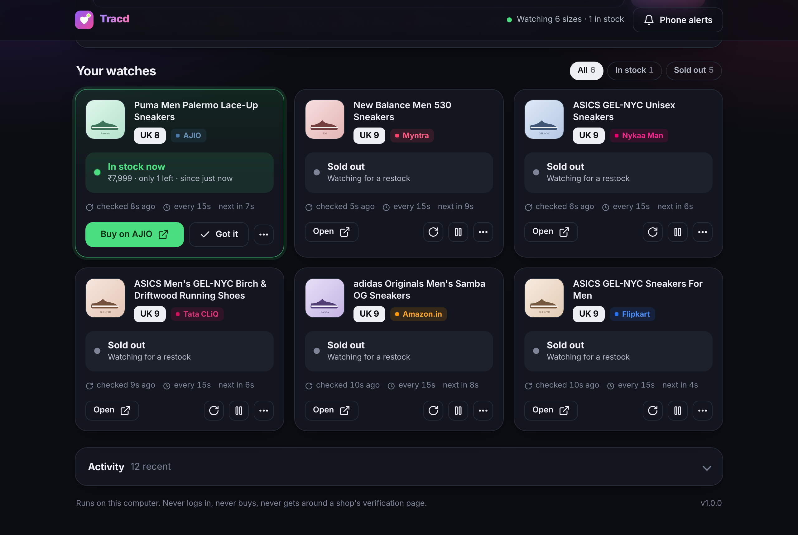
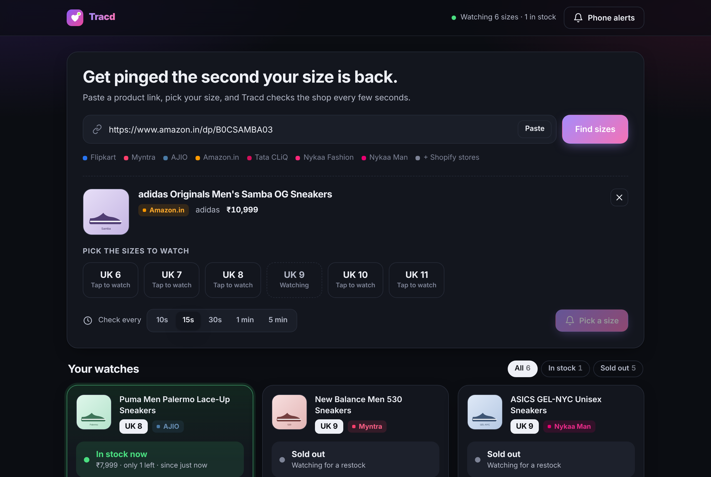
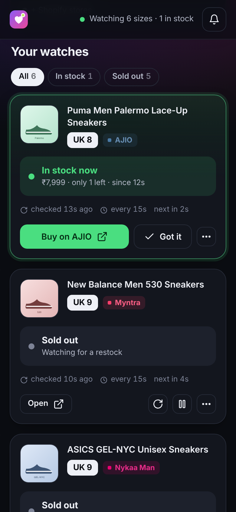

<p align="center"></p>

<h1 align="center">Tracd</h1>

<p align="center"><b>Get pinged the second your size is back.</b><br>
Instant restock alerts for the exact size you want on Flipkart, Myntra, AJIO, Amazon.in, Tata CLiQ and Nykaa.</p>

<p align="center"></p>

Paste a product link, tap your size, and Tracd checks the shop every few seconds. When your size comes back, your phone gets a loud alert with a button that opens that size's page, ready to buy.

- **Seconds, not hours.** Checks every 10 to 30 seconds (you choose). Hosted trackers check every 2 minutes at best, and their free plans check hourly.
- **Your size, not just the product.** It reads the shop's own stock data for each size, so "in stock" means *your* size is buyable.
- **No false alarms.** If a shop's answer can't be read, it says so and never guesses "in stock". If a shop stays unreadable, you're told, so a quiet tracker never hides a broken one.
- **Alerts you'll notice.** An urgent push from ntfy and/or Telegram, repeated until you tap "Got it". The page also opens on your computer and it beeps.
- **Every shop at once.** All shops are checked in parallel, so a slow shop never delays the others. Two sizes of the same item cost one request.
- **Private and polite.** Everything runs on your own computer. It never logs in, never adds to cart, never buys, and never tries to get around a shop's verification page.

## Shops

| Shop | Size list | How stock is read |
|---|---|---|
| Flipkart | ✓ | The size's own page (each size has its own `pid`), from its product data |
| Myntra | ✓ | Every size from the page's product data, including units left |
| AJIO | ✓ | AJIO's own product API, with a fallback to the page |
| Amazon.in | ✓ | The size's own page (each size is its own ASIN): availability and Add to Cart |
| Tata CLiQ | ✓ | Tata CLiQ's own product API, which lists every size |
| Nykaa Man / Nykaa | ✓ | Every size from the page's product data, including units left |
| Nykaa Fashion | ✓ | The page's product data |
| Shopify stores (many Indian D2C brands) | ✓ | The store's variant feed |
| Any other shop | Best effort | The page's structured product data |

Share links from the shop apps (`dl.flipkart.com/s/…`, `amzn.in/d/…`, `myntr.it/…`) work too. You can paste the whole share message.

## Start it

### Windows

1. Install [Python 3.10 or newer](https://www.python.org/downloads/) and tick **Add python.exe to PATH**.
2. Download this repository (green **Code** button, then **Download ZIP**) and unzip it.
3. Double-click **`start.bat`**.

The first run takes about a minute to set up. After that, the dashboard opens in your browser at <http://127.0.0.1:8723>. Tracd uses the Chrome or Edge already on your PC. A minimised browser window appears: that's the tracker's own window. Leave it open.

To have it start whenever you sign in, run this once from the folder:

```bat
.venv\Scripts\python -m tracd autostart on
```

### macOS / Linux

```sh
./start.sh
```

If you have neither Chrome nor Edge, also run `.venv/bin/python -m playwright install chromium` once.

### Try it without real shops

`start.bat --demo` (or `./start.sh --demo`) runs the whole app against simulated shops, where a sold-out size restocks every minute or so. It's a quick way to see an alert reach your phone.

## Phone alerts

Open **Phone alerts** in the dashboard. It walks you through these steps:

**ntfy (recommended, free, no account)**
1. Install ntfy for [Android](https://play.google.com/store/apps/details?id=io.heckel.ntfy) or [iPhone](https://apps.apple.com/app/ntfy/id1625396347).
2. Tap **+** and subscribe to the topic the dashboard shows, or scan its QR code. The topic is random and private to you.
3. On Android, turn on **Instant delivery** for the topic so alerts land within a second.
4. Tap **Send a test alert**.

**Telegram (optional)**: create a bot with @BotFather, paste its token, send the bot any message, and tap **Find my chat**.

## Using it

<p align="center"></p>

- **Pick several sizes at once.** For example, UK 9 and UK 9.5.
- **Check now** asks the shop right away. **Pause** stops checking a size without forgetting it.
- **Got it** stops the reminder alerts for that restock. You'll still be alerted the next time it comes back.
- **History** in the ⋯ menu shows every time the size came and went.
- If a shop shows a verification page, the card turns red with an **Open shop window** button. Clear the check there yourself, and checking resumes.
- Keep the computer awake and online. Tracd stops Windows and macOS from sleeping while it runs, but a closed laptop lid still stops it.
- **On your phone:** start with `--lan` and open the link it prints (it includes a private key) while on the same Wi-Fi.

<p align="center"></p>

## Command line

```text
tracd                       start the tracker and open the dashboard
tracd --demo                try it with simulated shops
tracd --lan                 also serve the dashboard to your phone on the same Wi-Fi
tracd --show-browser        keep the tracker's browser window visible
tracd check <link>          read one product link and list its sizes and stock
tracd check <link> --size "UK 9" --save dump/ ...and keep the raw responses (for bug reports)
tracd test-alert            send a test alert
tracd autostart on|off      start with your computer
```

(Inside the folder, `tracd` is `.venv\Scripts\python -m tracd` on Windows and `.venv/bin/python -m tracd` elsewhere.)

Data lives in `%APPDATA%\Tracd` on Windows and `~/.tracd` elsewhere. Set `TRACD_HOME` to change it. The log is `tracd.log` in that folder.

## How it works

```
 dashboard (your browser) ──HTTP/SSE──▶ local server ──▶ checker ──▶ shop readers ──▶ one real browser tab per shop
                                                           │                          (same-origin fetch, like the shop's own page)
                                                           └──▶ ntfy / Telegram / beep / open page
```

Shops refuse scripts and cloud servers, but they answer a normal browser on a home connection. So every request is made from inside a real browser tab on the shop's own site, with the shop's own cookies. It's the same request the shop's page makes for itself. Each shop reader then reads the data behind the page (JSON-LD, the page's boot state, or the shop's own product API) rather than the page layout, which changes often. When a shop moves its data, a shape-based fallback finds size lists by what they look like, not by a fixed path.

A check only says "in stock" when the shop's data for that exact size says so. If it can't tell, the answer is "can't read right now", the checker backs off, and it reloads the tab after a few misses.

## Development

```sh
python -m venv .venv && . .venv/bin/activate
pip install -e ".[test]"
python -m playwright install chromium
pytest
```

The tests cover every shop reader against pages built the way each shop builds them, the checker's alert logic, the alert channels, the API and its safety checks. They also run the real browser path and the dashboard in Chromium, with the shops stood in for by request interception, so they run offline.

Shops change their pages. If one stops reading, `tracd check <link> --save dump/` saves exactly what the shop sent, which is all that's needed to fix its reader.

## License

MIT
