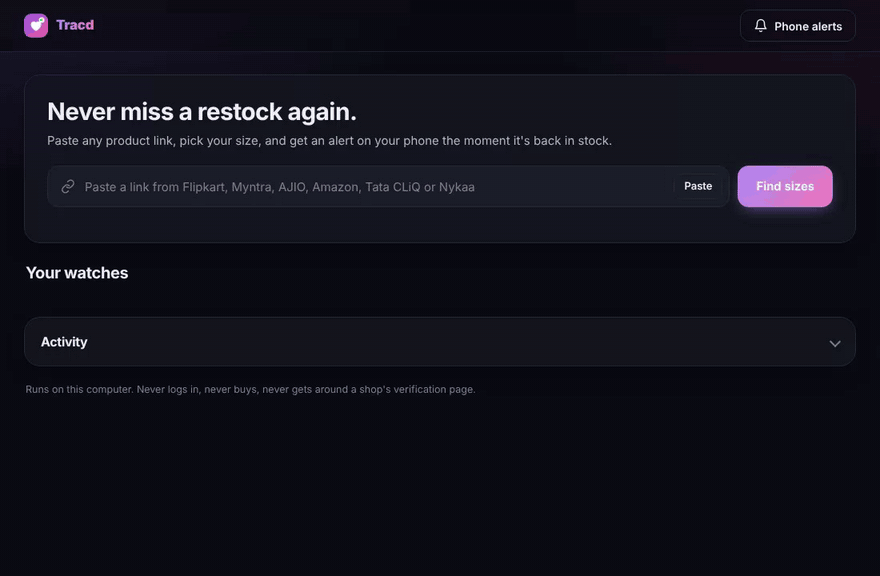

<p align="center"></p>

<h1 align="center">Tracd</h1>

<h3 align="center">Never miss a restock again.</h3>

<p align="center">
Paste any product link, pick your size, and Tracd alerts your phone the moment it's back in stock,<br>
while it's still there to buy.
</p>

<p align="center"><b>Public beta:</b> tested on real pages for Flipkart and Tata CLiQ. Help test the rest and <a href="https://github.com/furmak331/Tracd/issues/new?template=shop-not-reading.yml">report a shop</a> that doesn't read.</p>

<p align="center">
<a href="https://github.com/furmak331/Tracd/actions/workflows/tests.yml"></a>


</p>

<p align="center"></p>

The shoes you wanted sold out in your size. They'll be back, maybe at 2 a.m., maybe for ten minutes. Tracd keeps watch for you: it checks the shop every few seconds and sends a loud alert to your phone the moment your size returns, with a button that opens the page ready to buy.

## Why Tracd

- **⚡ Seconds, not hours.** Checks every 10 to 30 seconds, your choice. Most online trackers check hourly or slower on their free plans, which is too slow for a popular size.
- **🎯 Your size, not just the product.** A product page says "in stock" if any size is left. Tracd reads the stock of the exact size you picked, so an alert means *you* can buy it.
- **📱 Alerts you can't miss.** An urgent push to your phone through the free ntfy app or Telegram, repeated until you tap **Got it**. Your computer chimes and opens the page too.
- **🛍️ Every big Indian fashion shop.** Flipkart, Myntra, AJIO, Amazon.in, Tata CLiQ, Nykaa Fashion, Nykaa Man, and Shopify stores, all watched at once. A slow shop never holds up the others.
- **🙅 No false alarms.** If a shop's answer can't be read, Tracd says so instead of guessing. If a shop stays unreadable for a while, it tells you, so a quiet Tracd never means a broken one.
- **🔒 Free, private, yours.** No account and no subscription. It runs on your own computer, never logs in to a shop, never adds to cart, never buys anything for you.

| | Tracd | Typical online restock tracker |
|---|---|---|
| How often it checks | Every 10–30 seconds | Hourly or slower on free plans |
| Watches your exact size | ✓ | Often only the whole product |
| Urgent phone alert that repeats until you tap | ✓ | Rarely |
| Account needed | No | Usually |
| Cost | Free | Paid plans for faster checks |

## How it works

1. **Paste a link.** Copy it from the shop's website or app. Share links and whole share messages work too.
2. **Pick your sizes.** Tracd lists every size with its current stock. Choose one or several, and how often to check.
3. **Get pinged.** When a size comes back, your phone buzzes with the price, how many are left, and a button that opens the page.

<p align="center"></p>

## Get started in a minute

**Windows**

1. Install [Python 3.10 or newer](https://www.python.org/downloads/) and tick **Add python.exe to PATH**.
2. Download Tracd (green **Code** button, then **Download ZIP**) and unzip it.
3. Double-click **`start.bat`**.

The dashboard opens at <http://127.0.0.1:8723>. The first run takes about a minute to set up. Tracd uses the Chrome or Edge already on your PC, and a minimised browser window appears: that's Tracd's own window, so leave it open.

To start Tracd every time you sign in, run this once from the folder:

```bat
.venv\Scripts\python -m tracd autostart on
```

**macOS / Linux**

```sh
./start.sh
```

If you have neither Chrome nor Edge, also run `.venv/bin/python -m playwright install chromium` once.

**Just looking?** `start.bat --demo` (or `./start.sh --demo`) runs Tracd against pretend shops where a sold-out size restocks every minute or so. It's the quickest way to see an alert land on your phone.

## Set up phone alerts

Open **Phone alerts** in the dashboard and follow along. It takes two minutes.

**ntfy (recommended, free, no account)**
1. Install ntfy for [Android](https://play.google.com/store/apps/details?id=io.heckel.ntfy) or [iPhone](https://apps.apple.com/app/ntfy/id1625396347).
2. Scan the QR code in the dashboard, or tap **+** and type the topic it shows. The topic is random and private to you.
3. On Android, turn on **Instant delivery** for the topic so alerts arrive within a second.
4. Tap **Send a test alert**.

**Telegram (optional):** create a bot with @BotFather, paste its token, send the bot any message, then tap **Find my chat**.

## Supported shops

| Shop | Status | Every size listed | Where the stock comes from |
|---|---|---|---|
| Flipkart | ✅ Tested on real pages | ✓ | Each size's own page, plus the size picker for the full list |
| Tata CLiQ | ✅ Tested on real pages | ✓ | Tata CLiQ's own product API, which lists every size |
| Myntra | 🧪 Beta, please report | ✓ | The page's product data, including units left |
| AJIO | 🧪 Beta, please report | ✓ | AJIO's own product API, with the page as a fallback |
| Amazon.in | 🧪 Beta, please report | ✓ | Each size's own page: availability and Add to Cart |
| Nykaa Man / Nykaa | 🧪 Beta, please report | ✓ | The page's product data, including units left |
| Nykaa Fashion | 🧪 Beta, please report | ✓ | The page's product data |
| Shopify stores (many Indian D2C brands) | 🧪 Beta, please report | ✓ | The store's variant feed |
| Any other shop | Best effort | Sometimes | The page's structured product data |

If a shop doesn't read, `tracd check <link> --save dump/` saves exactly what it sent. [Open a "Shop not reading" issue](https://github.com/furmak331/Tracd/issues/new?template=shop-not-reading.yml) with it and it can be fixed. See [CONTRIBUTING.md](CONTRIBUTING.md).

<p align="center"></p>

## Tips

- **Watch several sizes at once,** for example UK 9 and UK 9.5.
- **Got it** stops the reminders for this restock. You'll still be alerted the next time it comes back.
- **Check now** asks the shop right away. **Pause** stops checking without forgetting the size.
- **History** in the ⋯ menu shows every time a size came and went.
- **If a shop asks you to verify you're human,** the card turns red with an **Open shop window** button. Clear the check there yourself and Tracd carries on.
- **Keep the computer on and online.** Tracd stops Windows and macOS from sleeping while it runs, but closing a laptop lid still pauses it.
- **See the dashboard on your phone:** start with `--lan` and open the link it prints while on the same Wi-Fi.

<p align="center"></p>

## FAQ

**Does my computer need to stay on?** Yes. Tracd runs on your computer, not on a server, which is what makes it fast, free and private. Shops also block checks from cloud servers but answer a normal browser at home.

**Will Tracd buy the item for me?** No. It never logs in, adds to cart or buys anything. It tells you the moment your size is back and opens the page, and you buy it yourself.

**Will the shop block me?** Tracd checks the way a person browsing would, from a real browser with only a couple of requests to a shop at a time, and it backs off when a shop is slow or shows a verification page. A check every 10 to 30 seconds per item is gentle.

**Is it free?** Yes, and open source under the MIT license. ntfy and Telegram are free too.

## Command line

```text
tracd                       start the tracker and open the dashboard
tracd --demo                try it with simulated shops
tracd --lan                 also serve the dashboard to your phone on the same Wi-Fi
tracd --show-browser        keep the tracker's browser window visible
tracd check <link>          read one product link and list its sizes and stock
tracd check <link> --size "UK 9" --save dump/ ...and keep the raw responses (for bug reports)
tracd test-alert            send a test alert
tracd autostart on|off      start with your computer
```

(Inside the folder, `tracd` is `.venv\Scripts\python -m tracd` on Windows and `.venv/bin/python -m tracd` elsewhere.)

Data lives in `%APPDATA%\Tracd` on Windows and `~/.tracd` elsewhere. Set `TRACD_HOME` to change it. The log is `tracd.log` in that folder.

## Under the hood

```
 dashboard (your browser) ──HTTP/SSE──▶ local server ──▶ checker ──▶ shop readers ──▶ one real browser tab per shop
                                                           │                          (same-origin fetch, like the shop's own page)
                                                           └──▶ ntfy / Telegram / beep / open page
```

Shops refuse scripts and cloud servers, but they answer a normal browser on a home connection. So every request is made from inside a real browser tab on the shop's own site, with the shop's own cookies. It's the same request the shop's page makes for itself. Each shop reader then reads the data behind the page (JSON-LD, the page's boot state, or the shop's own product API) rather than the page layout, which changes often. When a shop moves its data, a shape-based fallback finds size lists by what they look like, not by a fixed path.

A check only says "in stock" when the shop's data for that exact size says so. If it can't tell, the answer is "can't read right now", the checker backs off, and it reloads the tab after a few misses.

## Development

```sh
python -m venv .venv && . .venv/bin/activate
pip install -e ".[test]"
python -m playwright install chromium
pytest
```

The tests cover every shop reader against pages built the way each shop builds them, the checker's alert logic, the alert channels, the API and its safety checks. They also run the real browser path and the dashboard in Chromium, with the shops stood in for by request interception, so they run offline.

Shops change their pages. If one stops reading, `tracd check <link> --save dump/` saves exactly what the shop sent, which is all that's needed to fix its reader.

## License

MIT
